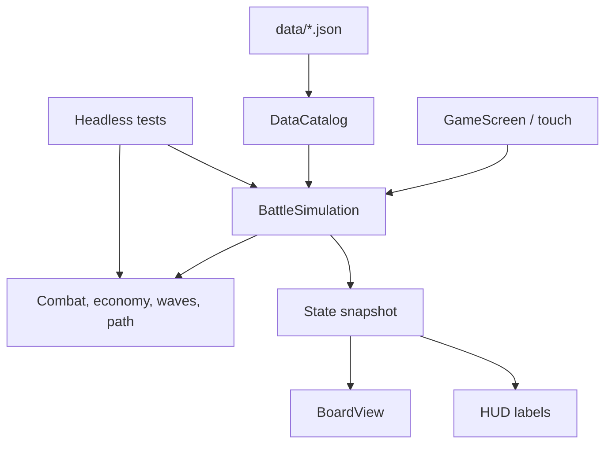

# Αρχιτεκτονική

## Κατευθυντήριες αρχές

Το PULSE είναι ένα offline Godot 4 project γραμμένο σε GDScript. Για 2D παιχνίδι με μικρό και προβλέψιμο runtime, ενσωματωμένη υποστήριξη Android/touch και εξαγωγή APK, το Godot είναι κατάλληλη επιλογή. Χρησιμοποιούμε Compatibility renderer για ευρεία υποστήριξη συσκευών και αποφεύγουμε πρόσθετα runtime dependencies. Το Android build γίνεται σε CI, επειδή ο χρήστης αναπτύσσει αποκλειστικά από Android.

Η βάση είναι η σταθερή Godot 4.7.2. Η επίσημη τεκμηρίωση Android export περιγράφει το απαιτούμενο JDK 17, Android SDK και matching export templates για desktop/CI builds: [Godot 4.7 Android export](https://docs.godotengine.org/en/4.7/tutorials/export/exporting_for_android.html), [Godot 4.7.2 release](https://godotengine.org/download/archive/4.7.2-stable/).

Οι κανόνες προσομοίωσης είναι `RefCounted` GDScript χωρίς εξάρτηση από SceneTree ή γραφικά. Η σκηνή παρουσιάζει snapshots και στέλνει εντολές· δεν αποφασίζει ζημιά, στόχευση ή οικονομία. Έτσι οι βασικοί υπολογισμοί τρέχουν με `--headless` και ελέγχονται χωρίς rendering.

## Ροή δεδομένων

## Ευθύνες

| Περιοχή | Ευθύνη | Δεν αναλαμβάνει |
|---|---|---|
| `data/` | Τιμές πύργων, εχθρών, χάρτη και κύματος σε JSON | Κανόνες εκτέλεσης |
| `core/data_catalog.gd` | Φόρτωση/βασική επικύρωση JSON | UI ή gameplay decisions |
| `core/battle_simulation.gd` | Σταθερός χρόνος, οντότητες μάχης, εντολές και νίκη/ήττα | Σχεδίαση ή χειρισμός widgets |
| `combat/` | Ζημιά, στόχευση, λήξη/ανανέωση εξασθενήσεων | Αποθήκευση ή εμφάνιση εφέ |
| `economy/` | Αγορές, ανταμοιβές και συναθροίσεις ενισχυτών | Επιλογή στόχου |
| `towers/` | Κατάσταση επιπέδου και νόμιμη σειρά αναβαθμίσεων | Κώδικας UI |
| `enemies/`, `units/` | Κατάσταση αντιπάλου, κίνηση διαδρομής, μετρητής στρατιωτών | Γραφικά μονάδων |
| `waves/` | Χρονοπρογραμματισμός spawn και ολοκλήρωση κύματος | Αμοιβές/ζημιά πύργων |
| `visuals/` | Απόδοση χάρτη, θέσεων, πύργων και εχθρών | Κανόνες μάχης |
| `ui/` | HUD, touch events και αποστολή εντολών | Άμεση μεταβολή HP/χρυσού |
| `tests/` | Επαναλήψιμοι έλεγχοι χωρίς γραφικά | Έλεγχος οπτικής ποιότητας σε συσκευή |

## Σταθερή προσομοίωση

Η `BattleSimulation` συσσωρεύει πραγματικό `delta` και προχωρά με βήμα 0,1 δευτερολέπτου. Το spawn, η κίνηση, οι βολές και οι διαρροές εκτελούνται με σταθερή σειρά. Η τυχαιότητα δεν χρησιμοποιείται στην πρώτη πίστα· όπου προστεθεί αργότερα θα περνά από ρητό seed. Η απεικόνιση λαμβάνει στιγμιότυπο κατάστασης, όχι αναφορές σε εσωτερικά αντικείμενα.

## Προσθήκη περιεχομένου

- Αλλαγή ισορροπίας: επεξεργασία του αντίστοιχου JSON και ενημέρωση του `BALANCE.md`.
- Νέος πύργος: προσθήκη δεδομένων και συμπεριφοράς που χρησιμοποιεί τα κοινά rules. Δεν απαιτεί αναγραφή των ήδη υπαρχόντων τύπων.
- Νέος εχθρός: δεδομένα και, αν έχει μοναδική ικανότητα, μικρή απομονωμένη συμπεριφορά/στρατηγική. Ο κοινός κύκλος μάχης παραμένει αμετάβλητος.
- Νέα πίστα: νέο JSON με διαδρομή, θέσεις και κύματα, χωρίς αλλαγή σε UI ή κανόνες κίνησης.
- Νέα εμφάνιση: αντικατάσταση του `BoardView`/scene assets χωρίς αλλαγές στα rules.

Δεν υλοποιείται ακόμη γενικό σύστημα plugin συμπεριφορών. Οι διεπαφές και τα JSON δεδομένα καλύπτουν το τρέχον πραγματικό περιεχόμενο· θα προστεθεί επέκταση μόνο όταν υπάρξει δεύτερη συγκεκριμένη συμπεριφορά που τη χρειάζεται.
